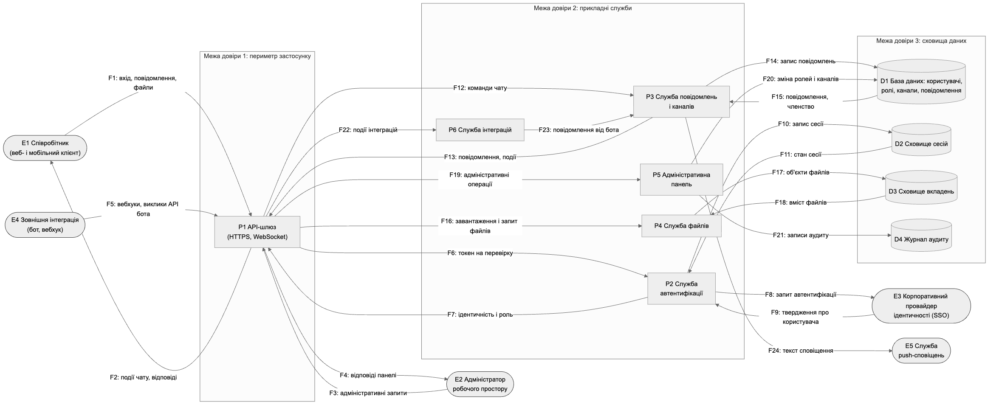
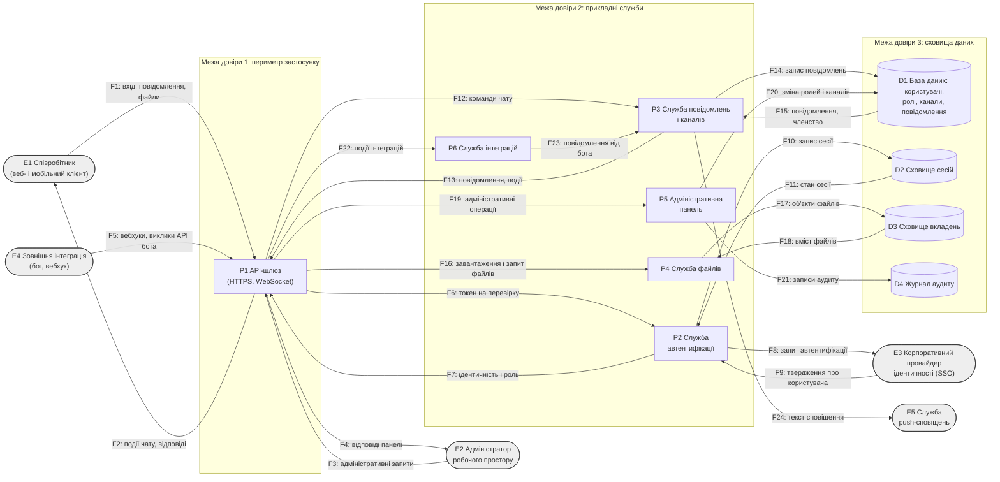

# Модель загроз: внутрішній чат-сервіс компанії

Лабораторна робота 1 з дисципліни «Безпека програмного забезпечення». Варіант 12: об'єкт моделювання – внутрішній чат-сервіс компанії; пріоритетна категорія STRIDE – підвищення привілеїв (Elevation of privilege). Виконав: Ломакін Максим, група ІП-33.

## 1. Опис системи та активи

Об'єкт моделювання – **внутрішній чат-сервіс компанії** (навчальна вигадана система, умовна назва «КорпЧат»). Сервіс призначений для робочого спілкування співробітників: публічні й приватні канали, особисті листування, обмін файлами, пошук в історії повідомлень. Доступ можливий із браузера та з мобільного застосунку, зокрема з-поза офісної мережі, тому API-шлюз сервісу доступний з Інтернету.

**Користувачі.** Співробітник (роль `member`) читає й пише в канали, учасником яких він є. Власник каналу керує складом учасників свого каналу. Адміністратор робочого простору (роль `admin`) керує обліковими записами, ролями, каналами та інтеграціями і має доступ до журналу аудиту.

**Зовнішні служби.** Корпоративний провайдер ідентичності (єдиний вхід, SSO) автентифікує співробітників і передає сервісу твердження про користувача та його групи. Зовнішні інтеграції (боти, вебхуки систем CI та моніторингу) публікують повідомлення в канали за окремими токенами. Стороння служба push-сповіщень доставляє сповіщення на мобільні пристрої.

**Чому для системи важлива авторизація.** У чаті одночасно працюють суб'єкти з дуже різними правами (учасник, власник каналу, адміністратор, бот), а в приватних каналах обговорюються кадрові, фінансові й технічні питання. Тому головний клас загроз для такої системи – обхід розмежування доступу, що й відповідає пріоритетній категорії варіанта (Elevation of privilege).

Цінність активів за властивостями К/Ц/Д (конфіденційність/цілісність/доступність): В – висока, С – середня, Н – низька. Усі дані в моделі синтетичні.

| № | Актив | Тип | К/Ц/Д |
|---|---|---|---|
| A1 | Вміст повідомлень приватних каналів та особистих листувань | дані | В/В/С |
| A2 | Облікові записи, ролі та членство в каналах | дані розмежування доступу | С/В/С |
| A3 | Токени сесій і ключ підпису токенів доступу | секрети | В/В/С |
| A4 | Вкладені файли (документи, знімки екрана) | дані | В/С/С |
| A5 | Журнал аудиту адміністративних дій | журнал подій | С/В/Н |
| A6 | Токени ботів і секрети вебхуків | секрети | В/В/Н |
| A7 | Безперервність роботи чату | послуга | Н/С/В |

## 2. Діаграма потоків даних

Діаграма зберігається у файлі `dfd.mmd`, зображення – у `dfd.png`.





| Позначення | Елемент | Тип | Межа довіри |
|---|---|---|---|
| E1 | Співробітник (веб- і мобільний клієнт) | зовнішня сутність | поза межами довіри |
| E2 | Адміністратор робочого простору | зовнішня сутність | поза межами довіри |
| E3 | Корпоративний провайдер ідентичності (SSO) | зовнішня сутність | поза межами довіри |
| E4 | Зовнішня інтеграція (бот, вебхук) | зовнішня сутність | поза межами довіри |
| E5 | Служба push-сповіщень | зовнішня сутність | поза межами довіри |
| P1 | API-шлюз (HTTPS, WebSocket) | процес | межа 1: периметр застосунку |
| P2 | Служба автентифікації | процес | межа 2: прикладні служби |
| P3 | Служба повідомлень і каналів | процес | межа 2: прикладні служби |
| P4 | Служба файлів | процес | межа 2: прикладні служби |
| P5 | Адміністративна панель | процес | межа 2: прикладні служби |
| P6 | Служба інтеграцій | процес | межа 2: прикладні служби |
| D1 | База даних: користувачі, ролі, канали, повідомлення | сховище даних | межа 3: сховища даних |
| D2 | Сховище сесій | сховище даних | межа 3: сховища даних |
| D3 | Сховище вкладень | сховище даних | межа 3: сховища даних |
| D4 | Журнал аудиту | сховище даних | межа 3: сховища даних |

## 3. Загрози за STRIDE

| № | Елемент або потік | Категорія STRIDE | Опис загрози | Порушувана властивість |
|---|---|---|---|---|
| T-01 | P3 Служба повідомлень і каналів | E – Elevation of privilege | Співробітник підставляє у запит ідентифікатор чужого приватного каналу; служба перевіряє лише чинність сесії, а не членство в каналі, тому він читає історію й публікує повідомлення в каналі, до якого не має доступу (CWE-639, CWE-862). | авторизація |
| T-02 | P5 Адміністративна панель | E – Elevation of privilege | Користувач із роллю member напряму викликає маршрути адміністративного API (зміна ролей, видалення каналів): перевірку ролі виконано лише в інтерфейсі клієнта, а поле role приймається з тіла запиту під час оновлення профілю (CWE-862, CWE-915). | авторизація |
| T-03 | P2 Служба автентифікації | E – Elevation of privilege | Неавтентифікований порушник підробляє токен доступу з роллю admin: служба приймає токен з alg=none або підписаний слабким чи розкритим ключем і довіряє полю role з токена, тож порушник отримує повні права адміністратора робочого простору (CWE-347, CWE-321). | авторизація |
| T-04 | P6 Служба інтеграцій | E – Elevation of privilege | Бот, якому видано токен для публікації в одному каналі, викликає методи API читання історії інших каналів і керування учасниками: область дії (scope) токена не перевіряється, діє лише факт його чинності (CWE-863). | авторизація |
| T-05 | P4 Служба файлів | E – Elevation of privilege | Співробітник завантажує файл з іменем, що містить «../», або з виконуваним вмістом; файл потрапляє в каталог, з якого служба виконує код, і порушник діє з правами облікового запису служби файлів замість прав учасника чату (CWE-22, CWE-434). | авторизація |
| T-06 | P1 API-шлюз (HTTPS, WebSocket) | E – Elevation of privilege | Шлюз передає прикладним службам заголовки X-User-Id та X-User-Role, не вилучаючи однойменні заголовки із вхідного запиту; автентифікований співробітник додає X-User-Role: admin, і служби за шлюзом вважають його адміністратором (CWE-290). | авторизація |
| T-07 | P3 Служба повідомлень і каналів | E – Elevation of privilege | Співробітник публікує повідомлення зі шкідливим сценарієм, який служба зберігає й віддає без екранування; коли повідомлення відкриває адміністратор, сценарій від його імені викликає адміністративний API й призначає порушникові роль admin (CWE-79). | авторизація |
| T-08 | E1 Співробітник (веб- і мобільний клієнт) | S – Spoofing | Порушник входить від імені співробітника, використавши пароль, отриманий фішингом або з витоку іншого сервісу; другий чинник не вимагається, кількість спроб входу не обмежено (CWE-307, CWE-308). | автентичність |
| T-09 | E4 Зовнішня інтеграція (бот, вебхук) | S – Spoofing | Порушник надсилає запит на адресу вхідного вебхука, видаючи себе за систему CI: адреса вебхука є єдиним секретом, підпис запиту не перевіряється, тому в канал потрапляє фальшиве повідомлення від імені довіреного бота (CWE-345). | автентичність |
| T-10 | P2 Служба автентифікації | S – Spoofing | Порушник надсилає службі автентифікації сформоване ним твердження SAML нібито від провайдера ідентичності; через помилку перевірки підпису (обгортання підпису XML) служба створює сесію від імені довільного співробітника (CWE-347). | автентичність |
| T-11 | F1: потік «співробітник → API-шлюз» | T – Tampering | У відкритій мережі порушник у позиції «людина посередині» знижує з'єднання до незахищеного HTTP (заголовок HSTS не встановлено) і змінює текст повідомлень та посилання в них на шляху між клієнтом і шлюзом (CWE-319). | цілісність |
| T-12 | D1 База даних: користувачі, ролі, канали, повідомлення | T – Tampering | Через рядок пошуку по історії повідомлень, що підставляється в SQL-запит без параметризації, співробітник змінює записи бази даних: редагує чужі повідомлення, змінює таблицю ролей і членства (CWE-89). | цілісність |
| T-13 | D3 Сховище вкладень | T – Tampering | Ключ об'єкта у сховищі вкладень будується з послідовного номера, а посилання на завантаження не прив'язане до власника; співробітник перезаписує чуже вкладення файлом зі зміненим вмістом (CWE-639). | цілісність |
| T-14 | E2 Адміністратор робочого простору | R – Repudiation | Адміністратор видаляє канал або змінює чужу роль і згодом заперечує це: адміністративні дії виконуються під спільним службовим обліковим записом і не журналюються з ідентифікатором виконавця (CWE-778). | неспростовність |
| T-15 | D4 Журнал аудиту | R – Repudiation | Журнал аудиту зберігається у звичайній таблиці, доступній адміністраторові на запис; після зловживання він видаляє або редагує записи про власні дії, і довести авторство стає неможливо (CWE-779, CWE-117). | неспростовність |
| T-16 | D2 Сховище сесій | I – Information disclosure | Сховище сесій доступне з внутрішньої мережі без автентифікації; порушник, що під'єднався до офісної мережі, читає чинні токени сесій усіх користувачів (CWE-306). | конфіденційність |
| T-17 | F24: потік «служба повідомлень → push-служба» | I – Information disclosure | У сторонню push-службу передається повний текст повідомлення, зокрема з приватних каналів; текст стає доступним провайдеру сповіщень і відображається на заблокованому екрані пристрою (CWE-201). | конфіденційність |
| T-18 | P1 API-шлюз (HTTPS, WebSocket) | D – Denial of service | Автентифікований клієнт відкриває тисячі WebSocket-з'єднань і надсилає повідомлення без обмеження частоти; шлюз вичерпує з'єднання й пам'ять, чат стає недоступним для всіх (CWE-770). | доступність |
| T-19 | D3 Сховище вкладень | D – Denial of service | Співробітник багаторазово завантажує великі файли; за відсутності квот на користувача сховище вкладень заповнюється, і завантаження нових файлів тимчасово неможливе (CWE-400). | доступність |

Розподіл за категоріями: S – 3, T – 3, R – 2, I – 2, D – 2, E – 7.

## 4. Оцінювання ризиків

Базові оцінки обчислено калькулятором `cvss.py` (файл `scoring.py`). Рівень за матрицею – добуток імовірності та впливу (1–3): 1–2 – низький, 3–4 – середній, 6 – високий, 9 – критичний. Ранг – місце за спаданням базової оцінки, за однакових оцінок – за рівнем матриці. Жирним виділено загрози високого ризику (оцінка не нижче 7,0).

| № | Вектор CVSS | Оцінка | Рівень CVSS | Імовірність | Вплив | Рівень за матрицею | Ранг |
|---|---|---|---|---|---|---|---|
| **T-01** | **CVSS:3.1/AV:N/AC:L/PR:L/UI:N/S:U/C:H/I:H/A:N** | **8,1** | **високий (високий ризик)** | **висока** | **висока** | **критичний** | **5** |
| **T-02** | **CVSS:3.1/AV:N/AC:L/PR:L/UI:N/S:U/C:H/I:H/A:H** | **8,8** | **високий (високий ризик)** | **середня** | **висока** | **високий** | **2** |
| **T-03** | **CVSS:3.1/AV:N/AC:L/PR:N/UI:N/S:U/C:H/I:H/A:H** | **9,8** | **критичний (високий ризик)** | **висока** | **висока** | **критичний** | **1** |
| **T-04** | **CVSS:3.1/AV:N/AC:L/PR:L/UI:N/S:U/C:H/I:L/A:N** | **7,1** | **високий (високий ризик)** | **середня** | **середня** | **середній** | **10** |
| **T-05** | **CVSS:3.1/AV:N/AC:H/PR:L/UI:N/S:U/C:H/I:H/A:H** | **7,5** | **високий (високий ризик)** | **низька** | **висока** | **середній** | **8** |
| **T-06** | **CVSS:3.1/AV:N/AC:L/PR:L/UI:N/S:U/C:H/I:H/A:H** | **8,8** | **високий (високий ризик)** | **середня** | **висока** | **високий** | **3** |
| **T-07** | **CVSS:3.1/AV:N/AC:L/PR:L/UI:R/S:C/C:H/I:H/A:N** | **8,7** | **високий (високий ризик)** | **середня** | **висока** | **високий** | **4** |
| **T-08** | **CVSS:3.1/AV:N/AC:L/PR:N/UI:R/S:U/C:H/I:H/A:N** | **8,1** | **високий (високий ризик)** | **висока** | **висока** | **критичний** | **6** |
| T-09 | CVSS:3.1/AV:N/AC:L/PR:N/UI:N/S:U/C:N/I:L/A:N | 5,3 | середній | середня | низька | низький | 15 |
| **T-10** | **CVSS:3.1/AV:N/AC:H/PR:N/UI:N/S:U/C:H/I:H/A:N** | **7,4** | **високий (високий ризик)** | **низька** | **висока** | **середній** | **9** |
| T-11 | CVSS:3.1/AV:N/AC:H/PR:N/UI:N/S:U/C:N/I:H/A:N | 5,9 | середній | низька | середня | низький | 14 |
| **T-12** | **CVSS:3.1/AV:N/AC:L/PR:L/UI:N/S:U/C:H/I:H/A:N** | **8,1** | **високий (високий ризик)** | **середня** | **висока** | **високий** | **7** |
| T-13 | CVSS:3.1/AV:N/AC:L/PR:L/UI:N/S:U/C:N/I:H/A:N | 6,5 | середній | середня | середня | середній | 11 |
| T-14 | CVSS:3.1/AV:N/AC:L/PR:H/UI:N/S:U/C:N/I:L/A:N | 2,7 | низький | середня | низька | низький | 19 |
| T-15 | CVSS:3.1/AV:N/AC:L/PR:H/UI:N/S:U/C:N/I:H/A:N | 4,9 | середній | низька | середня | низький | 16 |
| T-16 | CVSS:3.1/AV:A/AC:L/PR:N/UI:N/S:U/C:H/I:N/A:N | 6,5 | середній | низька | висока | середній | 13 |
| T-17 | CVSS:3.1/AV:N/AC:H/PR:N/UI:N/S:U/C:L/I:N/A:N | 3,7 | низький | висока | низька | середній | 18 |
| T-18 | CVSS:3.1/AV:N/AC:L/PR:L/UI:N/S:U/C:N/I:N/A:H | 6,5 | середній | середня | середня | середній | 12 |
| T-19 | CVSS:3.1/AV:N/AC:L/PR:L/UI:N/S:U/C:N/I:N/A:L | 4,3 | середній | середня | низька | низький | 17 |

## 5. Реєстр ризиків і рішення

| № | Вихідний ризик | Рішення | Контрзахід | Залишковий ризик |
|---|---|---|---|---|
| T-03 | 9,8 (критичний) | зменшити | К2: сувора перевірка токенів: єдиний дозволений алгоритм EdDSA, відхилення alg=none, приватний ключ у сховищі секретів із ротацією, строк дії токена 15 хв, токен не передається в URL; К3: повторне підтвердження другим чинником (step-up MFA) перед адміністративними операціями; стан підтвердження зберігається на сервері | низький |
| T-02 | 8,8 (високий) | зменшити | К1: єдиний серверний модуль авторизації «суб'єкт – дія – об'єкт» із забороною за замовчуванням: роль і членство читаються з бази даних для кожного запиту; К3: повторне підтвердження другим чинником (step-up MFA) перед адміністративними операціями; стан підтвердження зберігається на сервері | низький |
| T-06 | 8,8 (високий) | усунути | К4: шлюз вилучає вхідні заголовки X-User-*; служби приймають ідентичність лише з підписаного внутрішнього токена через взаємний TLS (причину прибрано: зовнішній заголовок більше не є джерелом ідентичності) | низький |
| T-07 | 8,7 (високий) | зменшити | К7: екранування виводу й санітизація розмітки повідомлень, політика CSP, cookie з HttpOnly і SameSite; К3: повторне підтвердження другим чинником (step-up MFA) перед адміністративними операціями; стан підтвердження зберігається на сервері | низький |
| T-01 | 8,1 (високий) | зменшити | К1: єдиний серверний модуль авторизації «суб'єкт – дія – об'єкт» із забороною за замовчуванням: роль і членство читаються з бази даних для кожного запиту | низький |
| T-08 | 8,1 (високий) | передати | К5: вхід лише через корпоративний SSO з обов'язковим другим чинником, обмеження кількості спроб входу (автентифікацію делеговано провайдеру ідентичності; цільовий фішинг із перехопленням другого чинника лишається можливим) | середній |
| T-12 | 8,1 (високий) | усунути | К8: параметризовані запити (ORM) та обліковий запис бази даних із мінімальними правами (причину прибрано: дані користувача не потрапляють у текст запиту) | низький |
| T-05 | 7,5 (високий) | зменшити | К9: генеровані імена файлів (UUID), перевірка типу вмісту, зберігання поза виконуваними каталогами, служба файлів у контейнері без прав root | низький |
| T-10 | 7,4 (високий) | зменшити | К6: перевірка підпису тверджень SAML перевіреною бібліотекою, контроль одержувача, строку дії та ідентифікатора запиту | низький |
| T-04 | 7,1 (високий) | зменшити | К10: токени ботів з областю дії на конкретний канал (перевіряє К1); HMAC-підпис вебхуків із міткою часу; К1: єдиний серверний модуль авторизації «суб'єкт – дія – об'єкт» із забороною за замовчуванням: роль і членство читаються з бази даних для кожного запиту | низький |
| T-13 | 6,5 (середній) | зменшити | К1: єдиний серверний модуль авторизації «суб'єкт – дія – об'єкт» із забороною за замовчуванням: роль і членство читаються з бази даних для кожного запиту (додатково: ключі об'єктів UUID, посилання лише на читання зі строком дії 5 хв) | низький |
| T-18 | 6,5 (середній) | зменшити | К15: обмеження частоти запитів і кількості з'єднань на користувача на рівні шлюзу | низький |
| T-16 | 6,5 (середній) | зменшити | К13: автентифікація й TLS для сховища сесій, ізольований мережевий сегмент, зберігання гешів токенів | низький |
| T-11 | 5,9 (середній) | зменшити | К12: TLS 1.3 із заголовком HSTS, закріплення сертифіката в мобільному клієнті | низький |
| T-09 | 5,3 (середній) | зменшити | К10: токени ботів з областю дії на конкретний канал (перевіряє К1); HMAC-підпис вебхуків із міткою часу | низький |
| T-15 | 4,9 (середній) | зменшити | К11: журнал аудиту лише на додавання в окремому сховищі з геш-ланцюжком записів; персональні облікові записи адміністраторів | низький |
| T-19 | 4,3 (середній) | прийняти | К16: нових заходів не вводять; діють наявне обмеження розміру файла 50 МБ і моніторинг заповнення сховища. Обґрунтування: порушник – автентифікований співробітник, якого легко встановити за обліковим записом; збиток обмежується тимчасовою неможливістю завантажувати файли, тоді як підсистема квот потребує розроблення й супроводу, дорожчих за очікуваний збиток | середній |
| T-17 | 3,7 (низький) | усунути | К14: push-сповіщення без тексту повідомлення («Нове повідомлення»), вміст завантажує сам застосунок (причину прибрано: текст не залишає меж системи; лишається розкриття самого факту повідомлення) | низький |
| T-14 | 2,7 (низький) | зменшити | К11: журнал аудиту лише на додавання в окремому сховищі з геш-ланцюжком записів; персональні облікові записи адміністраторів | низький |

Перекриття листків дерева атак контрзаходами (К3 додатково перекриває всі три гілки):

| Лист | Дія порушника | Контрзахід |
|---|---|---|
| 1.1 | токен з alg=none | К2 – дозволено лише EdDSA, токен без підпису відхиляється |
| 1.2.1.1 | підбір слабкого ключа HS256 | К2 – асиметричний ключ, підбирати нема чого |
| 1.2.1.2 | ключ у репозиторії чи образі | К2 – ключ лише у сховищі секретів, регулярна ротація |
| 1.2.2 | виклик адміністративного API з підробленим токеном | К1 – роль читається з бази даних, а не з токена |
| 1.3 | плутанина алгоритмів RS256/HS256 | К2 – алгоритм зафіксовано на боці сервера |
| 2.1–2.2 | підроблене твердження SAML | К6 – коректна перевірка підпису й одержувача |
| 3.1 | читання токена зі сховища сесій | К13 – автентифікація сховища, геші токенів |
| 3.2 | токен у журналі шлюзу | К2 – токен не передається в URL, строк дії 15 хв |

## 6. Дерево атак

Найкритичніша загроза – T-03 (базова оцінка 9,8).

```
Мета (T-03): отримати права адміністратора робочого простору без чинного облікового запису
  OR
  ├── 1. Підробити токен доступу з роллю admin
  │     OR
  │     ├── 1.1. Надіслати токен із заголовком alg=none, який служба P2 приймає без перевірки підпису
  │     ├── 1.2. Підписати токен справжнім ключем служби
  │     │     AND
  │     │     ├── 1.2.1. Отримати симетричний ключ підпису HS256
  │     │     │     OR
  │     │     │     ├── 1.2.1.1. Підібрати слабкий ключ за словником за одним перехопленим токеном
  │     │     │     └── 1.2.1.2. Знайти ключ у файлі конфігурації в репозиторії або в образі контейнера
  │     │     └── 1.2.2. Сформувати токен із role=admin, підписати його знайденим ключем і викликати
  │     │                адміністративний API
  │     └── 1.3. Змінити в заголовку токена RS256 на HS256 і підписати його відкритим ключем служби,
  │              опублікованим на /.well-known/jwks.json
  ├── 2. Увійти через SSO від імені адміністратора
  │     AND
  │     ├── 2.1. Сформувати твердження SAML з ідентифікатором адміністратора та групою chat-admins
  │     └── 2.2. Обгорнути ним справжній підписаний елемент (XML signature wrapping) і надіслати на
  │              маршрут приймання тверджень служби P2
  └── 3. Заволодіти чинною сесією адміністратора
        OR
        ├── 3.1. Прочитати токен сесії адміністратора зі сховища D2, доступного з внутрішньої мережі
        │        без автентифікації
        └── 3.2. Скопіювати токен адміністратора з журналу запитів шлюзу, куди він потрапляє в рядку
                 адреси WebSocket-з'єднання
```

## 7. Висновки

1. Побудовано модель загроз внутрішнього чат-сервісу компанії: 7 активів, діаграма потоків даних із 15 елементів, 24 потоків і трьох меж довіри, 19 загроз за STRIDE (вимога – не менше 12), з яких 10 мають базову оцінку CVSS не нижче 7,0 (вимога – не менше 3).
2. Домінує категорія Elevation of privilege: 7 загроз із 19 і 7 із 10 загроз високого ризику, середня оцінка 8,40. Для системи з кількома ролями й приватними каналами розмежування доступу є головною властивістю, яку треба закладати в проєкт.
3. Найкритичніша загроза – T-03 (підробка токена доступу з роллю адміністратора, 9,8, критичний рівень): вона досяжна з мережі, не потребує привілеїв і взаємодії з користувачем та дає повний вплив на всі три властивості; наступні за рангом T-02 і T-06 мають 8,8 лише тому, що потребують облікового запису співробітника.
4. Найбільший ефект за найменших витрат дають три проєктні рішення: К1 (єдина серверна авторизація із забороною за замовчуванням) перекриває 4 загрози – T-01, T-02, T-04, T-13; К3 (повторне підтвердження другим чинником для адміністративних дій) – 3 загрози (T-02, T-03, T-07) і всі три гілки дерева атак; К2 (сувора перевірка токенів) – чотири листки найдешевшої для порушника гілки дерева. Усі три є рішеннями рівня архітектури й на етапі проєктування майже нічого не коштують.
5. Після впровадження контрзаходів жодна загроза не лишається на високому рівні: 14 ризиків зменшено, 3 усунено, 1 передано провайдеру ідентичності, 1 прийнято. Середній залишковий ризик мають T-08 (цільовий фішинг) і прийнятий T-19.

### Аналіз отриманих результатів

**1. Розподіл загроз за категоріями STRIDE.** Із 19 загроз на підвищення привілеїв припадає 7, на спуфінг і підміну даних – по 3, на відмову від авторства, розкриття інформації та відмову в обслуговуванні – по 2. Гіпотеза варіанта підтвердилася: пріоритетна категорія Elevation of privilege є найчисленнішою, і до того ж найважчою – усі 7 її загроз мають оцінку не нижче 7,0 (середня 8,40 проти 5,83 у решти категорій), тобто 7 із 10 загроз високого ризику належать саме їй. Причина в природі системи: чат має багато ролей (учасник, власник каналу, адміністратор, бот) і багато об'єктів з окремими правами (канали, файли), а за таблицею застосовності категорія E стосується лише процесів, яких у моделі шість, і кожен із них ухвалює власні рішення про доступ.

**2. Найвразливіші елементи діаграми.** Процеси породили 9 із 19 загроз, сховища – 5, зовнішні сутності – 3, потоки – 2. Найбільше загроз у служб повідомлень P3 (T-01, T-07), автентифікації P2 (T-03, T-10), шлюзу P1 (T-06, T-18) та сховища вкладень D3 (T-13, T-19). Спільне в перших трьох – розташування на межі довіри: P1 приймає всі потоки з недовіреної зони (F1, F3, F5), P2 приймає твердження від зовнішнього провайдера (F9) і перетворює недовірений токен на ідентичність, якій далі вірять усі служби, а P3 першою отримує ідентифікатори об'єктів, що їх задає користувач, і сама звертається до сховищ. Загалом елементи межі 2 дали 7 загроз: саме тут дані з менш довіреної зони стають підставою для рішень про доступ.

**3. Чому T-03 має найвищу оцінку CVSS.** Вектор CVSS:3.1/AV:N/AC:L/PR:N/UI:N/S:U/C:H/I:H/A:H дає 9,8: підоцінка впливу 5,87, підоцінка експлуатованості 3,89 – максимально можлива для незмінної області. Найбільший внесок робить PR:N: порушникові не потрібен жоден обліковий запис. Якби був потрібен запис співробітника (PR:L), експлуатованість знизилася б до 2,84, а оцінка – до 8,8, як у T-02 і T-06; за PR:H – до 7,2. Так само впливає AV:N (за AV:A оцінка була б 8,8): шлюз доступний з Інтернету. Вплив повний за всіма трьома властивостями (C:H/I:H/A:H), бо адміністратор читає всі канали, змінює ролі й може видалити робочий простір; без впливу на доступність оцінка становила б 9,1. Отже, T-03 відрізняється від інших загроз категорії E не тяжкістю наслідків, а тим, що підвищення відбувається одразу з нульових привілеїв до найвищих.

**4. Найефективніший контрзахід.** У реєстрі найбільше загроз перекриває К1 – єдиний серверний модуль авторизації із забороною за замовчуванням: 4 загрози (T-01, T-02, T-04, T-13), з яких 3 – високого ризику. У дереві атак найширше діє К3 (повторне підтвердження другим чинником перед адміністративними операціями): воно стоїть між будь-яким здобутим токеном і метою атаки, тому перекриває всі три гілки, тоді як К2 закриває чотири з п'яти листків гілки 1, а п'ятий (1.2.2) – К1. Ці заходи ефективніші за точкові, бо усувають спільну причину: окремі перевірки в кожному маршруті означають стільки місць для помилки, скільки є маршрутів, і новий маршрут без перевірки відкритий за замовчуванням; єдиний модуль робить відсутність правила відмовою в доступі, його достатньо один раз перевірити й протестувати.

**5. Прийняті ризики.** Стратегію «прийняти» обрано лише для T-19 (заповнення сховища вкладень, оцінка 4,3, середній рівень). Можливий збиток малий і оборотний: тимчасово не завантажуються нові файли, листування працює, дані не втрачаються, а порушник є автентифікованим співробітником, якого встановлюють за обліковим записом і до якого застосовують організаційні заходи. Натомість підсистема квот на користувача потребує розроблення, обліку обсягів, інтерфейсу для адміністратора й супроводу. Вартість контрзаходу перевищує очікуваний збиток, тому достатньо наявних обмеження розміру файла й моніторингу заповнення; рішення слід переглянути, якщо сервіс відкриють для зовнішніх підрядників.
